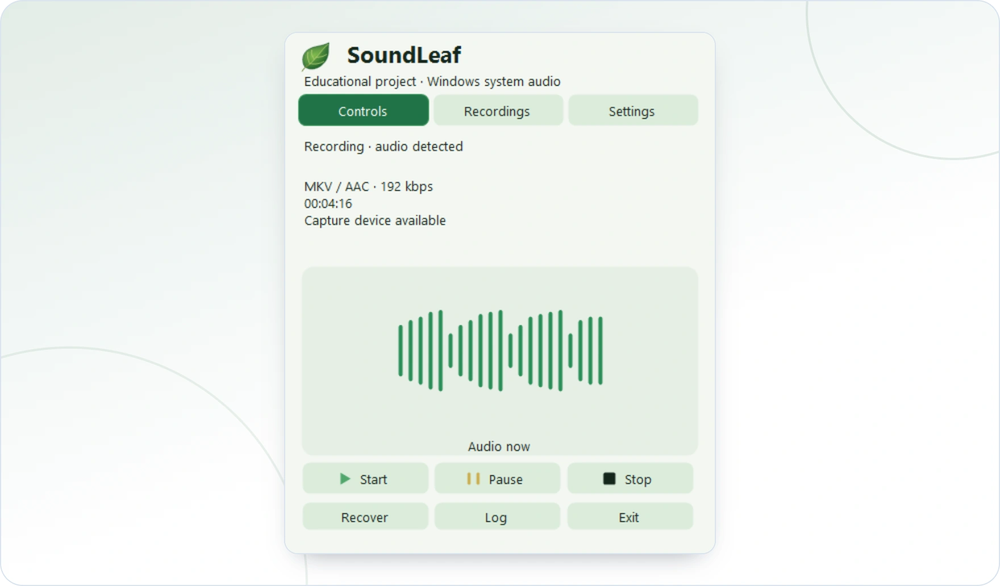

<!-- ppk-readme:head:start -->
<a href="https://popovantondev.github.io/SoundLeaf/index-en.html"><picture><source media="(prefers-color-scheme: dark)" srcset="https://raw.githubusercontent.com/popovantondev/SoundLeaf/main/docs/readme/header-en-dark.f4107c90.svg"></picture></a>
<!-- ppk-readme:head:end -->

# SoundLeaf

[Русский](README.ru.md) · [Deutsch](README.md) · **English**

<!-- ppk-readme:body:start -->
<p>
<a href="https://github.com/popovantondev/SoundLeaf/releases/tag/v3.0.5"><picture><source media="(prefers-color-scheme: dark)" srcset="https://raw.githubusercontent.com/popovantondev/SoundLeaf/main/docs/readme/btn-download-en-dark.75bd785c.svg"></picture></a>
<a href="https://popovantondev.github.io/SoundLeaf/index-en.html"><picture><source media="(prefers-color-scheme: dark)" srcset="https://raw.githubusercontent.com/popovantondev/SoundLeaf/main/docs/readme/btn-website-en-dark.5c2d27f6.svg"></picture></a>
<a href="https://popovantondev.github.io/SoundLeaf/Guide-en.html"><picture><source media="(prefers-color-scheme: dark)" srcset="https://raw.githubusercontent.com/popovantondev/SoundLeaf/main/docs/readme/btn-guide-en-dark.919f1892.svg"></picture></a>
<a href="https://github.com/popovantondev/SoundLeaf/issues/new/choose"><picture><source media="(prefers-color-scheme: dark)" srcset="https://raw.githubusercontent.com/popovantondev/SoundLeaf/main/docs/readme/btn-bug-en-dark.9a5fb8f3.svg"></picture></a>
</p>

<p><a href="https://raw.githubusercontent.com/popovantondev/SoundLeaf/main/assets/screenshots/en-control-light.png"><picture><source media="(prefers-color-scheme: dark)" srcset="https://raw.githubusercontent.com/popovantondev/SoundLeaf/main/docs/readme/preview-en-dark.1e142af3.webp"></picture></a><br>
<sub><a href="https://raw.githubusercontent.com/popovantondev/SoundLeaf/main/assets/screenshots/en-control-light.png">Full screenshot</a></sub></p>

<picture><source media="(prefers-color-scheme: dark)" srcset="https://raw.githubusercontent.com/popovantondev/SoundLeaf/main/docs/readme/divider-dark.077d240f.svg"></picture>
<!-- ppk-readme:body:end -->

Educational Windows system-audio recording application with tray controls, WAV backup and checks before files are marked complete.

**Windows 11 · x64 · Preview 3.0.5**

*Actual interface with demonstration data; no recordings of real conversations.*

**Limitations:** unsigned educational Preview; practical testing is limited to one Windows computer. This is not a professional recording product. Original application rights and third-party licenses are separate.

## First steps

Verify SHA-256. Install Setup or extract the complete portable folder: FFmpeg, corresponding sources and notices are included. No administrator rights needed. Setup does not start capture; launching the application later begins recording after checks. Capture uses the default Windows output device, not the microphone.

[Release 3.0.5](https://github.com/popovantondev/SoundLeaf/releases/tag/v3.0.5) · [English guide](https://popovantondev.github.io/SoundLeaf/Guide-en.html) · [Deutsch](https://popovantondev.github.io/SoundLeaf/Guide-de.html) · [Русский](https://popovantondev.github.io/SoundLeaf/Guide-ru.html)

[Website — English](https://popovantondev.github.io/SoundLeaf/index-en.html) · [Deutsch](https://popovantondev.github.io/SoundLeaf/index.html) · [Русский](https://popovantondev.github.io/SoundLeaf/index-ru.html). Homepages and guides share light and dark leaf-inspired themes with matching localized application screenshots and a remembered theme choice.

The offline `SoundLeaf-3.0.5-Setup.exe` installs for the current user under `%LOCALAPPDATA%\Programs\SoundLeaf` without administrator rights. FFmpeg 9.0.2, corresponding sources and notices are included; installation does not need a download. The portable ZIP includes the same runtime. Setup does not launch the application or enable startup. Launching SoundLeaf later starts recording after successful checks. [Setup and removal](docs/SETUP.md). This is an unsigned educational preview, not a professional recording product. Check `SHA256SUMS.txt`; a checksum is not code signing.

## Legal notes

SoundLeaf records what Windows plays through the default output device. This includes the voices of other people in phone calls, video conferences and online meetings (for example Microsoft Teams or Zoom). The microphone is not recorded.

Consent of all participants: record conversations only if every participant has agreed beforehand after being informed. State the purpose, scope and storage location. If someone refuses or withdraws consent, stop recording and delete the file on request.

§ 201 StGB (German Criminal Code): in Germany, recording the privately spoken word without authorisation can be a criminal offence, and so can passing on such a recording. A learning purpose does not change this.

GDPR (DSGVO): voices are personal data. Outside purely personal or household use the GDPR applies, for example legal basis, informing the people concerned, purpose limitation and deletion. SoundLeaf stores recordings locally and uploads nothing; storage location and sharing are your responsibility.

Also respect copyright and the terms of the services whose sound you record. This project is not legal advice and does not guarantee legal compliance.

[§ 201 StGB](https://www.gesetze-im-internet.de/stgb/__201.html) · [GDPR (Regulation (EU) 2016/679)](https://eur-lex.europa.eu/legal-content/DE/TXT/?uri=CELEX:32016R0679)

<details>
<summary>Technical details</summary>

## Storage and recovery

- Capture the default Windows output device through WASAPI loopback; microphone capture is not implemented.
- Start, pause, resume and stop from the tray. Interface, notifications and documentation support German, Russian and English; language changes apply immediately.
- Green play: recording. Yellow bars: paused. Black square: stopped. A thicker rotating ring around a fixed, centered green triangle: saving. Red: failure or unfinished previous sessions while stopped.
- Durable WAV backup with live AAC encoding and one verified final MKV per session.
- Saving stages and an explicit final-file path; open the last verified output from the menu.
- Detect unfinished sessions and rebuild them from finalized or partial WAV parts. Originals are archived only after full verification.
- User-level startup option without administrator rights.
- Background checks before capture: durable folder write/rename, free space, and a short selected-profile encode/decode with a three-second limit per FFmpeg process.
- Explicit WAV-only recording when FFmpeg is unavailable; verified WAV parts and an atomic completion marker prevent deliberate WAV results being mistaken for crashes.

Recording starts automatically when SoundLeaf is launched only after its checks pass. Below 256 MiB free, capture is blocked. From 256 MiB to 1 GiB, or when space cannot be measured, the menu warns; these initial checks cannot guarantee enough space for the entire session. An FFmpeg failure offers “Start WAV-only recording” but never switches modes automatically. Only capture audio you are entitled to record, with any required participant consent. Silence is normal and is not treated as a fault.

Unfinished older sessions are tracked separately from the latest successful result. Recovery refuses missing/duplicate parts, active writers, incompatible formats and existing output names. A failed attempt leaves originals intact and may retain work files. Recovery archives in `Backups/RecoveredSessions` are not removed by the existing 24-hour cleanup of `Backups/RecordingParts`.

## Profiles, panel and recordings

The default remains **MKV / AAC 192 kbit/s**, with the source sample rate and channels. In Settings, choose one output format: MKV/AAC, OGG/Opus (initially 24 kbit/s, mono), MP3, M4A/AAC or AAC/ADTS. Opus uses 48 kHz, speech-oriented VBR and a target bitrate; file size is not guaranteed. MP3 uses CBR. Additional AAC/MP3 profiles use 48 kHz and retain mono/stereo; multichannel input is downmixed to stereo. Backup WAV retains original PCM.

Opus bitrates: 16/24/32/48/64/96/128. AAC and MP3: 64/96/128/160/192/256/320 kbit/s. Each format remembers its bitrate. Format and save folder can change only while stopped; a session keeps its immutable profile. Language and the light/dark/system theme change immediately, including during recording.

Left click toggles a compact leaf-themed panel: Controls, Recordings and Settings. Right click opens the fallback menu. Escape or clicking outside hides the panel, not the recording. There is no main window or taskbar button.

The panel appears immediately above the actual tray icon and hides immediately. Snapshot-based opening/closing was removed to avoid stutter and the late appearance of a native shadow. Its usual size is 430 × 520 logical pixels; it stays inside the monitor's work area with per-monitor DPI scaling. A missing icon rectangle uses the saved click position. Settings use compact rows, a one-line folder path with a full-path tooltip, and an audio-information tooltip. Below 450 logical pixels of available height, Settings splits into Audio / Files / Appearance. Recordings use height-dependent pages instead of scrollbars. Custom rounded selectors support Tab, arrows, Enter, Space and Escape; Escape closes a dropdown before hiding the panel. Displayed format names are lowercase; codec settings and audio behavior are unchanged.

Controls show a centered histogram of 21 separated rounded PCM-level columns above play/pause/stop, with 95% visual expressiveness. The live card uses a compact group of five bars; its quiet line is only 31 logical pixels wide. Each display has its own elapsed-time smoothing; input updates never snap the visible heights. Quiet input crossfades briefly to a stationary line; pause/stop immediately stop motion. Updates arrive every 50 ms and packets expire after 150 ms; the remaining drawing fades briefly (up to 200 ms of modeled envelope time, not a wall-clock guarantee). These are level indicators, not a waveform or frequency spectrum. Current indication turns on at approximately −48 dBFS RMS and off below −54 dBFS, suppressing weak noise and isolated peaks without altering recorded audio. Very quiet playback can remain visually quiet. “Audio detected” retains historical confirmation during breaks; device availability does not prove a particular application is audible. Capture, PCM, codecs, tray states and the natural leaf are unchanged.

Settings can select a writable save folder. Existing files are not moved; previously selected folders remain in the library. The default remains the existing application folder's `Recordings`. Custom destinations store their own `State/Sessions`, backups and recovery work alongside dated recording folders; retain that metadata when moving audio. Settings themselves stay beside the EXE.

The library loads in the background, newest first, with size, format and known duration. Its first page includes the active session, elapsed captured audio, PCM byte count and a small real-level display. Recording/paused/saving entries are explicitly unfinished and cannot be opened or converted as completed outputs. Verified WAV parts are grouped. Temporary outputs are excluded; old files without valid metadata are shown as existing, not verified, with unknown duration. Opening the list does not decode every recording. Open/reveal commands are available; deletion and moment markers are not implemented.

“Save in another format” creates a separate verified file from a selected recording, retaining the original. Choose its format, bitrate and destination. Re-encoding compressed audio cannot restore quality. Existing target names and wrong extensions are refused. A completed WAV session is read as one PCM stream.

The legacy local update helper `Install-Verified.ps1` is not the public Setup. Public Setup performs a fresh per-user installation only; nonempty destinations are refused. Partial checks cannot authorize a changed runtime. Existing recordings are never migrated or deleted; the current recorder is not replaced during release preparation.

Additional formats use one live encoder across WAV boundaries, with a bounded queue. If it fails, the final output is rebuilt directly from verified WAV PCM. Full decoding and a maximum 250 ms duration mismatch precede durable, no-overwrite publication and backup deletion. Each new session commits its profile before capture; recovery uses that profile, or MKV/AAC 192 for older sessions without one.

## Build and verification

<details>
<summary>Show build and verification</summary>

Release 3.0.5 is published on GitHub. Local release preparation produces source and portable x64 archives with SHA-256 files; the published 3.0.5 portable package includes FFmpeg. Extract the whole portable ZIP and follow its three-language README. For a source build, create `SoundLeaf.next.exe`, provide compatible FFmpeg at `tools/ffmpeg.exe` beside it, then launch from a writable folder. FFmpeg must provide AAC, libopus and libmp3lame for the respective profiles. For normal use, rename the tested candidate to `SoundLeaf.exe`.

Use Windows PowerShell 5.1 and the Windows .NET Framework compiler. No Python, Node.js or separate .NET SDK is needed to build SoundLeaf.

```powershell
powershell.exe -NoProfile -ExecutionPolicy Bypass -File .\Build-Launcher.ps1
powershell.exe -NoProfile -ExecutionPolicy Bypass -File .\Run-Checks.ps1
```

The full check requires `tools/ffmpeg.exe` and a working output device: its MKV and explicit WAV-fallback integration tests genuinely record system output in a private `Verification` folder. Other tests use synthetic data. Build and icon checks can be run separately without FFmpeg. The build script never replaces an installed EXE.

Practical testing is currently limited to the author's Windows computer. Physical power loss, a full real disk and multi-hour endurance have not been tested. Periodic flushing reduces but cannot eliminate loss on hardware failure. Changing or disconnecting the output device requires a new session. A spinning icon is not a percentage indicator.

No cloud upload or telemetry is implemented. Recordings, logs and local paths are private: do not attach them to public reports without review. Screenshots must use demonstration data.

</details>

## Screenshots, release and rights

Demonstration panel renders with synthetic level data, not recordings of real people. German and Russian screenshots are linked from the corresponding README files.

See [release preparation](docs/RELEASE.md). `Prepare-OfflineRelease.ps1` requires a clean committed tree, unchanged runtime inputs, exact encoder hashes and complete runtime evidence. `Test-Setup.ps1` exercises isolated offline installation/removal and the actual asynchronous wizard handler; `Test-OfflineRelease.ps1` checks archive contents and hashes. Legacy online 3.0.4 scripts are not the current release path. Repository preparation scripts do not publish or launch recording. Windows CI performs limited source/build/icon smoke checks, not full capture verification. Application rights remain unchanged; only the encoder build script has the approved LGPL exception.

Files are stored beside the executable: `Recordings`, `logs`, `Backups`, `State/Sessions`, and temporary `RecoveryWork`. Keep the entire application folder together, including WAV completion markers. Re-enable startup after moving the folder so the saved path is updated. WAV-only mode does not run FFmpeg: long recordings remain multiple verified parts of up to 256 MiB, not one unlimited WAV. After stopping, the result lists all paths and provides a folder-opening command; MKV was not created. A completion-marker failure keeps the audio and reports an error.

- User guide: [English](https://popovantondev.github.io/SoundLeaf/Guide-en.html) · [Deutsch](https://popovantondev.github.io/SoundLeaf/Guide-de.html) · [Русский](https://popovantondev.github.io/SoundLeaf/Guide-ru.html)
- [Architecture](docs/ARCHITECTURE.md) · [Verification](docs/VERIFICATION.md) · [Changelog](CHANGELOG.md)
- [Rights](https://popovantondev.github.io/SoundLeaf/rights-en.html) · [Third-party components](https://popovantondev.github.io/SoundLeaf/notices-en.html)

Public source visibility is for educational/portfolio inspection, not an open-source license. Original code rights and third-party component terms are separate. The published 3.0.5 release includes FFmpeg and its corresponding sources and notices.

</details>
